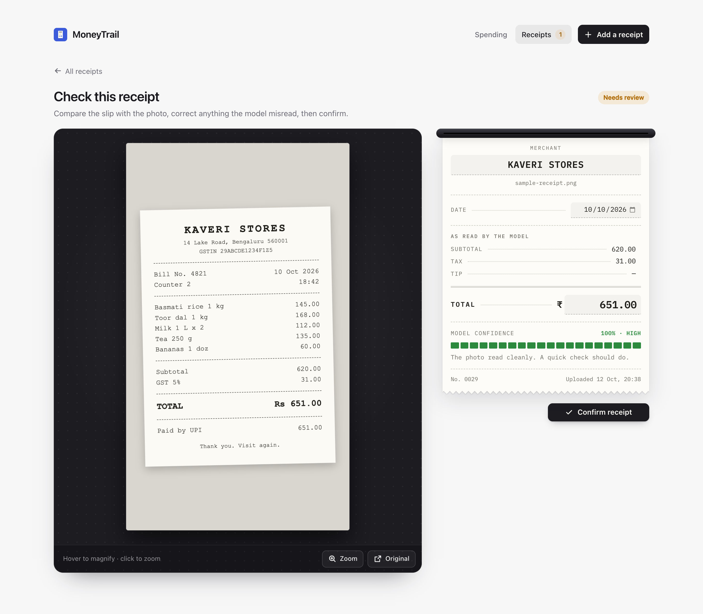
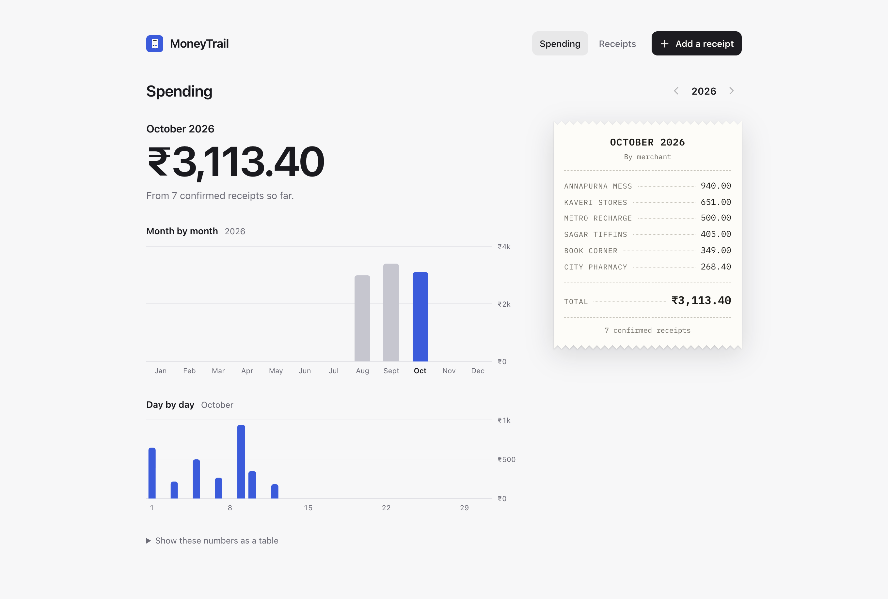
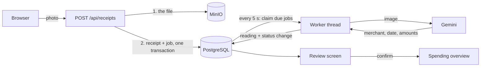
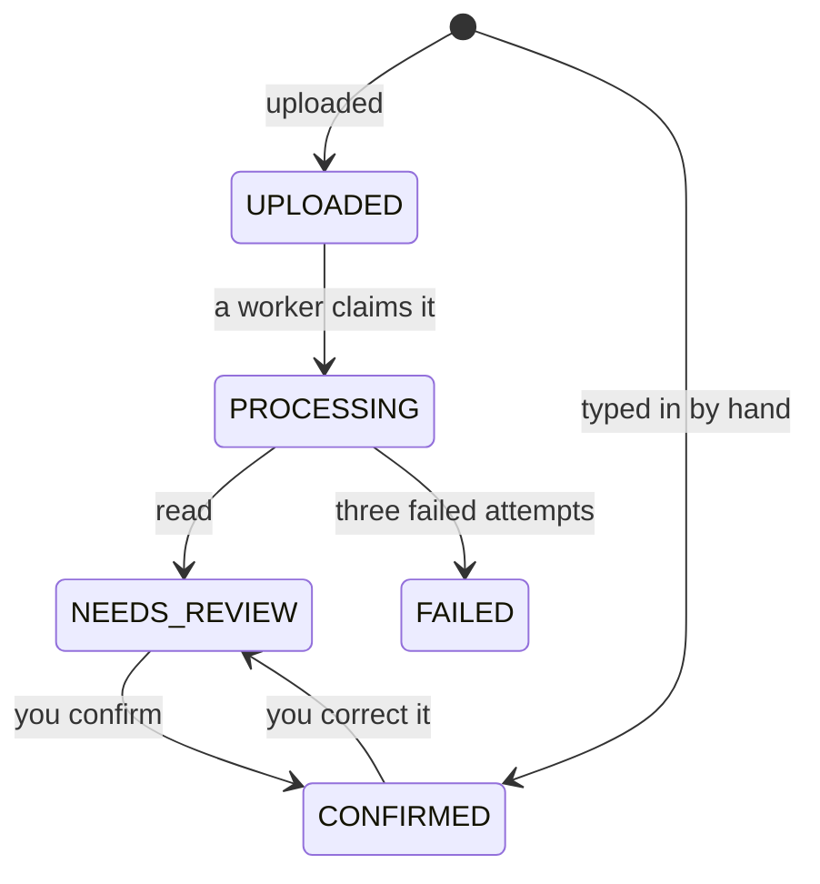

# MoneyTrail

Photograph a receipt. A background pipeline reads it with an LLM, you check what it read, and your
confirmed spending adds up by month, day and merchant.

It is a learning project about backend patterns: a job queue without a message broker, safe
retries, and state changes that survive two things happening at once. The receipt tracker is the
excuse to build them for real.



## What it does

- **Upload or photograph a receipt.** JPEG, PNG, HEIC or PDF. On a phone the Add page opens the
  camera, and the app installs to the home screen.
- **It is read in the background.** The upload returns at once. A worker sends the image to Gemini
  and stores the merchant, date and amounts it gets back.
- **Nothing is trusted automatically.** Every reading waits in a review queue. You compare it with
  the photo, correct what the model got wrong, and confirm.
- **Spending overview.** Confirmed receipts are totalled by month, by day and by merchant.
- **Entries without a receipt.** A cash spend can be typed in by hand and counts straight away.



## How a receipt moves through it



A receipt is always in exactly one status:



## The parts worth reading

**The queue is a database table.** There is no RabbitMQ or Kafka. Jobs are rows in
`processing_jobs`, and a scheduler claims them with one query:

```sql
SELECT * FROM processing_jobs
 WHERE (status = 'PENDING' AND (next_retry_at IS NULL OR next_retry_at <= :now))
    OR (status = 'RUNNING' AND locked_at < :staleBefore)
 ORDER BY created_at
 LIMIT :batchSize
 FOR UPDATE SKIP LOCKED
```

`FOR UPDATE SKIP LOCKED` lets several pollers take different rows at the same moment, with none
of them waiting on another.
See [`ProcessingJobRepository`](backend/src/main/java/com/moneytrail/pipeline/ProcessingJobRepository.java).

**A claim is a lease.** The second line of that `WHERE` picks up jobs that have been `RUNNING`
for more than five minutes. A worker that dies mid-job does not strand its receipt: the lease runs
out and another worker takes the job.

**Every claim counts as an attempt.** A job that crashes its worker each time would otherwise be
reclaimed forever. The attempt counter goes up when the job is claimed, not when it finishes, so
it reaches its limit of three and fails properly.
See [`ProcessingJob`](backend/src/main/java/com/moneytrail/pipeline/ProcessingJob.java).

**No transaction is held across the LLM call.** The call takes seconds. The worker claims the job
in one short transaction, calls the model with no transaction open, and writes the result in a
second short one, so a slow model never ties up a database connection.
See [`ProcessingJobWorker`](backend/src/main/java/com/moneytrail/pipeline/ProcessingJobWorker.java).

**Status changes check and write in one statement.** While the model is reading, you might open
the same receipt and confirm it yourself. The worker's final write is
`UPDATE receipts SET status = :to WHERE id = :id AND status = :from`. If the status moved in the
meantime, no row matches and the worker leaves the receipt alone. Its reading is still saved in
the history.
See [`ReceiptStateMachineService`](backend/src/main/java/com/moneytrail/receipt/ReceiptStateMachineService.java).

**What happened is kept apart from what is true.** `receipts` holds the current values and can be
corrected. `receipt_extractions` gets one row per attempt, successful or not, with the provider,
model and duration, and is never updated. That is what makes "how often is the model wrong, and
about what?" answerable later.

**The file is stored before the row is written.** A file with no row is harmless clutter; a row
pointing at a missing file would enter the pipeline and fail forever. If the database write fails,
the file is deleted again.
See [`ReceiptService`](backend/src/main/java/com/moneytrail/receipt/ReceiptService.java).

**Retries wait longer each time.** A failed attempt waits 30 seconds, the next 60. After the third
failure the job and the receipt are both marked `FAILED`.

**The database keeps its own rules.** A typed entry has no file, so the file columns allow nulls.
A `CHECK` constraint still refuses an uploaded receipt without one, whatever the Java does.
See [`V3__manual_entries.sql`](backend/src/main/resources/db/migration/V3__manual_entries.sql).

## Built with

| Part | What |
|---|---|
| Backend | Java 25, Spring Boot 4.1, Hibernate, Flyway |
| Database | PostgreSQL 16 |
| File storage | MinIO (S3-compatible) |
| Reading receipts | Gemini, called over plain HTTP |
| Frontend | React 19, TypeScript, Vite, plain CSS |
| Deployment | Docker Compose, with Caddy for HTTPS |

## Run it on your machine

You need Docker, JDK 25 or newer, and Node 24.

```bash
# 1. Database and file storage
docker compose up -d

# 2. Backend, on port 8080
cd backend
cp .env.example .env          # then put your Gemini API key in it
./mvnw spring-boot:run

# 3. Frontend, on port 5173 (in a second terminal)
cd frontend
npm install
npm run dev
```

Open <http://localhost:5173>. There is a receipt to try it with at
[`docs/sample-receipt.png`](docs/sample-receipt.png).

A Gemini API key is free from [Google AI Studio](https://aistudio.google.com/). To run without
one, set `EXTRACTION_PROVIDER=stub` in `backend/.env`: every receipt is then "read" as the same
fixed values, which is enough to watch the pipeline work.

## Deploy it

`docker-compose.prod.yml` runs the whole app on one server: database, storage, backend, and a
Caddy web server that serves the frontend and gets the HTTPS certificate by itself.

You need a server with 2 GB of memory and Docker, and a domain whose `A` record points at it, with
ports 80 and 443 open.

```bash
cp .env.example .env          # then fill it in: domain, passwords, Gemini key
docker compose -f docker-compose.prod.yml up -d --build
```

The app has no login of its own, so the web server puts the whole site behind one username and
password. `.env.example` explains how to set them.

## What is not built

- **Login.** Everything belongs to one user.
- **A way out for failed receipts.** A receipt the model could not read stays `FAILED`; it cannot
  be retried or deleted from the app yet.
- **Line items and categories.** The tables exist, and nothing fills them.
- **A summary endpoint.** The overview is added up in the browser from the receipt list.
- **Automated tests.** There is one, which starts the application. Everything else was checked by
  hand and with scripts.

Left out on purpose: reading bank SMS and UPI messages, so that spending without a receipt would
not need typing.

## Where things are

```
backend/     Spring Boot application
  src/main/java/com/moneytrail/
    pipeline/    the job queue: claiming, running, retrying
    receipt/     receipts, the review endpoints, the Gemini client
    storage/     MinIO
  src/main/resources/db/migration/    the schema, as Flyway migrations
frontend/    React application
docs/        notes written along the way
```
